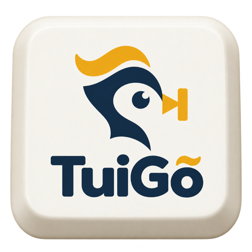

<p align="center">
  
</p>

<h1 align="center">
  TuiGoAI (Tui Gõ AI)
</h1>

<p align="center">
  <strong>Bộ gõ tiếng Việt tích hợp AI Copilot cho macOS</strong><br>
  Độ trễ tiệm cận 0ms · Tự động phục hồi tiếng Anh · Trợ lý AI inline tại con trỏ văn bản
</p>

<p align="center">
  
  
  
  
</p>

---

## Giới thiệu

TuiGoAI là bộ gõ tiếng Việt mã nguồn mở dành cho macOS, kết hợp giữa engine gõ tiếng Việt hiệu năng cao bằng Rust và lớp AI Copilot chạy offline:

1. Engine gõ tiếng Việt: Xử lý Telex và VNI bằng lõi Rust, độ trễ dưới 10ms, không lag và không nuốt phím trong Terminal hoặc IDE.
2. AI Copilot tại con trỏ: Gợi ý văn bản tiếp theo dạng ghost text ngay tại vị trí đang nhập liệu, chấp nhận gợi ý bằng phím Tab hoặc phím tắt tự chọn.
3. Chạy offline và bảo mật: AI chạy hoàn toàn nội bộ qua Ollama trên máy, không gửi phím bấm hay nội dung ra ngoài.

---

## Tải về & Cài đặt nhanh (Bản Alpha)

> [!NOTE]
> **TuiGoAI đang trong giai đoạn Alpha Preview.** Bản build hiện tại được phân phối dưới dạng **Ad-hoc/Community Release** (chưa ký chứng chỉ trả phí của Apple). Chúng tôi sẽ nâng cấp lên chứng chỉ Apple Developer ID ở giai đoạn Beta và Notarization chính thức khi ra mắt Official.

### 1. Tải bộ cài
👉 **[Tải TuiGoAI.dmg bản mới nhất từ GitHub Releases](https://github.com/ronnhd/TuiGoAI/releases)**

### 2. Cài đặt vào máy
1. Mở file `TuiGoAI.dmg` và kéo biểu tượng **TuiGoAI** vào thư mục **Applications**.
2. **Vượt qua cảnh báo kiểm dịch (Gatekeeper):**
   - **Cách 1 (Nhanh nhất):** Mở **Terminal** và chạy:
     ```bash
     xattr -cr /Applications/TuiGoAI.app
     ```
   - **Cách 2 (Giao diện):** Vào `Cài đặt hệ thống (System Settings) > Quyền riêng tư & Bảo mật (Privacy & Security)`, cuộn xuống mục Bảo mật và bấm **"Mở dù sao đi nữa" (Open Anyway)**.
3. **Cấp quyền Trợ năng (Accessibility):** Mở app lần đầu, vào `System Settings > Privacy & Security > Accessibility` và bật công tắc cho **TuiGoAI**.

### 3. Cài đặt Local AI (Ollama)
TuiGoAI AI Copilot chạy 100% offline trên máy bạn:
```bash
# Cài đặt mô hình được tối ưu tốt nhất cho văn bản tiếng Việt
ollama run qwen2.5:3b
```
*(Nếu máy cấu hình cơ bản 8GB RAM, bạn có thể dùng `ollama run qwen2.5:1.5b`)*

---

## Tính năng chính

### Bộ gõ tiếng Việt
- Xử lý Telex và VNI bằng lõi Rust độc lập, độ trễ tiệm cận 0ms.
- Tự động nhận diện và khôi phục từ tiếng Anh khi nhấn phím Space mà không cần chuyển chế độ gõ.
- Khôi phục chuỗi phím gốc bằng phím Escape khi gõ nhầm dấu.
- Đồng bộ bộ đệm gõ (Composition Buffer) với AI gợi ý, không bị nhảy dấu khi chấp nhận từ.
- Hoạt động ổn định trên TextEdit, Chrome, Safari, Slack, Telegram, VS Code, Cursor và Terminal.

### AI Copilot tại con trỏ (Inline Ghost Text)
- **Gợi ý tự nhiên tại con trỏ:** Gợi ý văn bản tiếp theo mờ nối liền sau con trỏ chuột, không che khuất chữ đang gõ.
- **Tiếp nhận linh hoạt:**
  - `Tab`: Chấp nhận toàn bộ câu gợi ý.
  - `Option + Mũi tên phải (⌥→)`: Nhận từng từ một (Word-by-word progressive acceptance).
  - `Esc`: Huỷ gợi ý ngay lập tức.
- **Ngữ cảnh thông minh (Context-Aware):**
  - **FIM (Fill-in-the-Middle):** Nhận biết chữ phía sau con trỏ để không gợi ý trùng lặp.
  - **Lịch sử hội thoại (Chat Memory):** Bắt nhịp xưng hô (anh/em, mình/bạn) theo phong cách người dùng trong các app chat (Telegram, Zalo, Slack...).
  - **Clipboard Context:** Tự động bắt từ khóa khi người dùng vừa sao chép nội dung liên quan.
  - **NLP Tiếng Việt chuyên sâu:** Bảo toàn từ láy toàn phần (*luôn luôn*, *từ từ*), khử lặp cụm từ (n-gram loops) và chuẩn hoá Unicode NFC toàn diện.
- **Tự động cập nhật (In-App Auto Update):** Tự động phát hiện phiên bản mới từ GitHub Releases và cài đặt tiện lợi.

---

## Lộ trình phát triển (Roadmap)

- [x] **Alpha (Hiện tại):** 
  - Hoàn thiện Core Rust IME + AI Copilot Inline Ghost Text.
  - Đóng gói `.dmg` Ad-hoc cho cộng đồng trải nghiệm sớm.
  - Hỗ trợ kênh cập nhật Prerelease (`0.1.0-alpha`).
- [ ] **Beta:**
  - Đăng ký và ký mã bằng **Apple Developer ID**.
  - Giữ cố định quyền Accessibility qua các bản cập nhật.
  - Tối ưu thêm mô hình cục bộ chuyên biệt cho tiếng Việt.
- [ ] **Official (Production):**
  - Apple Notarization chính thức (mở không cảnh báo).
  - Tự động phát hiện và quản lý tiến trình Ollama từ trong app.

---

## Cài đặt và build từ mã nguồn

### Yêu cầu hệ thống
- macOS 13.0 (Ventura) trở lên
- Xcode 15+ và Swift 6.0+
- Rust 1.80+
- Ollama (nếu sử dụng tính năng AI Copilot)

### Build ứng dụng
```bash
# 1. Clone repository
git clone https://github.com/ronnhd/TuiGoAI.git
cd TuiGoAI

# 2. Chạy kiểm thử lõi Rust
cargo test --manifest-path core/Cargo.toml

# 3. Build ứng dụng macOS
make build
```

File cài đặt sau khi build sẽ nằm tại `platforms/macos/build/Release/TuiGoAI.app`.

---

## Kiến trúc kỹ thuật

Dự án áp dụng nguyên tắc phân tách lõi nghiêm ngặt:

```text
┌────────────────────────────────────────────────────────┐
│                      macOS App                         │
│  (SwiftUI: MenuBar, Settings, Shortcuts, Overlay UI)   │
└──────────────┬──────────────────────────┬──────────────┘
               │ (Direct Events)          │ (Async Triggers)
               ▼                          ▼
┌─────────────────────────────┐  ┌───────────────────────┐
│     gonhanh-core (Rust)     │  │   TuiGoAI Copilot     │
│  Telex/VNI State Machine    │  │   Local Ollama / Raw  │
│  Latency < 10ms (Native)    │  │   AutocompleteCore    │
└─────────────────────────────┘  └───────────────────────┘
```

1. `core/`: Lõi Rust xử lý biến âm, từ điển kiểm tra âm tiết tiếng Việt và thuật toán khôi phục tiếng Anh.
2. `platforms/macos/`: Tầng Native macOS lắng nghe sự kiện bàn phím qua `CGEventTap` và quản lý giao diện.
3. `platforms/macos/AutocompleteCore.swift`: Thuật toán cân chỉnh biên con trỏ (`CaretBoundary`), kiểm soát trùng lặp đuôi (`SuffixOverlapGuard`) và phân tách từ (`NextWordSplitter`).
4. `platforms/macos/AIService.swift`: Giao tiếp bất đồng bộ với local Ollama qua raw generation.

---

## Bản quyền và ghi nhận

- Tác giả và phát triển: Ron Ng ([@ronnhd](https://github.com/ronnhd))
- Kế thừa nền tảng: Bộ gõ kế thừa nền tảng từ dự án [GoNhanh](https://github.com/khaphanspace/gonhanh.org) của tác giả Kha Phan.
- Thuật toán Autocomplete: Tham khảo và chuyển đổi từ dự án mã nguồn mở [KeyType](https://github.com/johnbean393/KeyType) (bản quyền Xi Nai Lai, giấy phép MIT).
- Giấy phép: Phát hành theo giấy phép [BSD-3-Clause](LICENSE).
